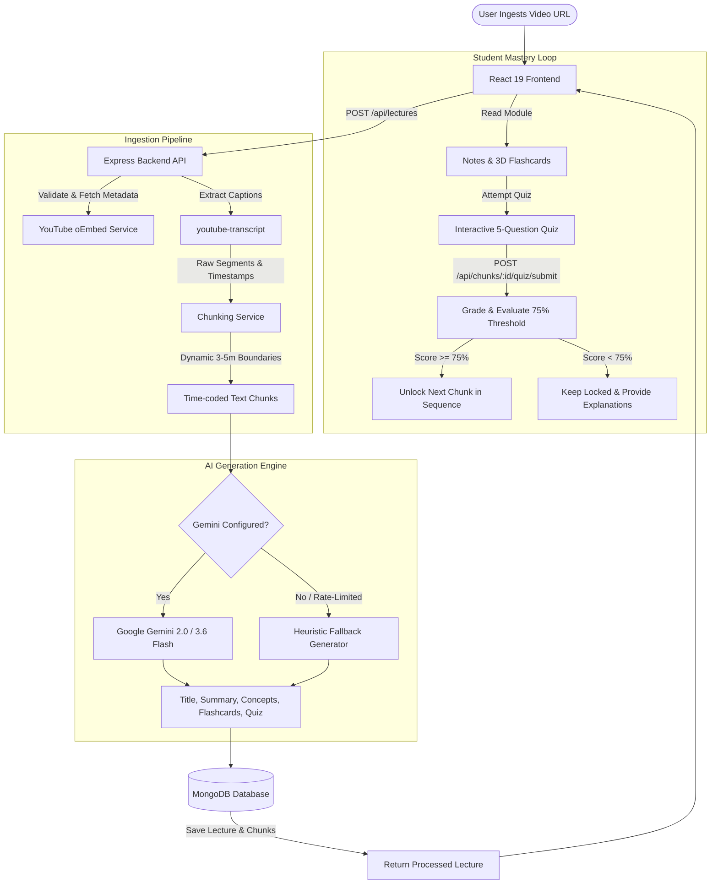

# 🎓 LearnLoop AI — Video Lecture Mastery Platform

> **Transform long video lectures into structured, bite-sized mastery modules powered by Google Gemini AI, interactive flashcards, and mastery-gated quizzes.**

[](https://react.dev/)
[](https://nodejs.org/)
[](https://expressjs.com/)
[](https://www.mongodb.com/)
[](https://ai.google.dev/)
[](https://vitejs.dev/)

---

## 📌 Table of Contents

- [Overview](#-overview)
- [Key Features](#-key-features)
- [Architecture & Processing Pipeline](#-architecture--processing-pipeline)
- [Tech Stack](#-tech-stack)
- [Project Structure](#-project-structure)
- [Database Models](#-database-models)
- [API Reference](#-api-reference)
- [Mastery Gating Workflow](#-mastery-gating-workflow)
- [Environment Configuration](#-environment-configuration)
- [Getting Started](#-getting-started)
- [Frontend User Flow](#-frontend-user-flow)
- [Resilience & Fallback Architecture](#-resilience--fallback-architecture)
- [Troubleshooting & FAQ](#-troubleshooting--faq)

---

## 📖 Overview

**LearnLoop AI** is a full-stack MERN application that solves the passive learning dilemma of long video lectures. Instead of watching hour-long videos without retention, LearnLoop parses lecture transcripts into logical 3–5 minute bite-sized segments, analyzes them with Google Gemini generative models, generates comprehensive study notes and 3D flashcards, and gates progression behind a strict **75% comprehension quiz**.

Students cannot move to the next segment until they have proven mastery over the current segment, reinforcing active recall and spaced learning.

---

## ✨ Key Features

- **🔐 End-to-End Authentication:**
  - Secure account registration and login with `bcryptjs` password hashing.
  - Stateless JWT issuance with Bearer token authentication.
  - Client-side auth persistence, route guards (`ProtectedRoute`), and auto-logout on token expiration.

- **📺 Intelligent Video Ingestion:**
  - Parses YouTube URLs across formats (`watch?v=`, `youtu.be`, `/embed/`, `/shorts/`).
  - Extracts official lecture titles and metadata via YouTube oEmbed API.
  - Fetches time-coded captions and subtitles using `youtube-transcript`.

- **✂️ Sentence-Aware Dynamic Chunking:**
  - Dynamically calculates target chunk durations (~3–5 minutes) based on total video length to produce 2 to 8 manageable modules.
  - Preserves punctuation boundaries (`[.!?]`), avoiding abrupt cuts in instructor explanations.

- **🤖 AI-Powered Learning Modules (Google Gemini):**
  - Integrated via `@google/generative-ai` (`gemini-3.6-flash` / `gemini-2.0-flash`).
  - Generates:
    - **Contextual Chunk Title:** Meaningful sub-topic naming.
    - **Multi-Paragraph Summary:** In-depth conceptual synthesis of the segment.
    - **Key Concepts:** Core terminologies and principles.
    - **Key Takeaways:** Bulleted practical conclusions.
    - **Interactive Flashcards:** 5 active-recall question-and-answer pairs per chunk.
    - **Comprehension Quiz:** 5 multiple-choice questions with 4 options and detailed explanations.

- **🛡️ Mastery Gating Mechanism:**
  - Chunk 1 is unlocked automatically upon ingestion.
  - Chunks $N > 1$ remain locked until the student scores $\ge 75\%$ on the quiz for Chunk $N-1$.
  - Correct answers are masked on the quiz retrieval endpoint to eliminate client-side inspection cheating.
  - Instant score grading with complete explanations for wrong and right answers.

- **🔄 Lecture Reprocessing:**
  - Dedicated endpoint to re-generate learning materials and quizzes if an API configuration changes or user requests re-synthesis.

- **🎨 Cyberpunk / Dark Glassmorphism Interface:**
  - Built with custom Vanilla CSS: high-contrast dark theme, neon accents, frosted glass navigation, dynamic progress bars, and 3D flip card animations.

---

## 🏛 Architecture & Processing Pipeline



---

## 🛠 Tech Stack

### Frontend
- **Framework:** [React 19](https://react.dev/) + [Vite 8](https://vitejs.dev/)
- **Routing:** [React Router v7](https://reactrouter.com/)
- **HTTP Client:** [Axios](https://axios-http.com/) (with JWT request interceptors)
- **Styling:** Custom CSS Design System (CSS variables, glassmorphism, 3D CSS transforms)

### Backend
- **Runtime:** [Node.js](https://nodejs.org/) (ES Modules)
- **Server Framework:** [Express 5](https://expressjs.com/)
- **Database & ODM:** [MongoDB](https://www.mongodb.com/) via [Mongoose 9](https://mongoosejs.com/)
- **Security & Authentication:** [bcryptjs](https://www.npmjs.com/package/bcryptjs) & [jsonwebtoken (JWT)](https://jwt.io/)
- **Environment Management:** `dotenv`

### External Integrations
- **AI Engine:** [@google/generative-ai](https://www.npmjs.com/package/@google/generative-ai) (Gemini Models)
- **Transcription Service:** [youtube-transcript](https://www.npmjs.com/package/youtube-transcript)

---

## 📂 Project Structure

```
LearnLoopAI/
├── client/                          # React Frontend Application (Vite)
│   ├── public/                      # Static assets & favicon
│   ├── src/
│   │   ├── components/              # Shared UI components
│   │   │   ├── Navbar.jsx           # Global navigation & logout
│   │   │   └── ProtectedRoute.jsx   # Route guard checking JWT auth state
│   │   ├── context/
│   │   │   └── AuthContext.jsx      # React Context for user state & token storage
│   │   ├── pages/                   # Application pages
│   │   │   ├── Dashboard.jsx        # Lecture catalog, submit modal, progress meters
│   │   │   ├── LecturePage.jsx      # Chunk viewer, notes, flashcards & quiz runner
│   │   │   ├── Login.jsx            # User sign in page
│   │   │   ├── Register.jsx         # User registration page
│   │   │   └── NotFound.jsx         # 404 handler
│   │   ├── services/
│   │   │   └── api.js               # Centralized Axios client & API methods
│   │   ├── App.jsx                  # Top-level routing layout
│   │   ├── index.css                # Full responsive design system & theme tokens
│   │   └── main.jsx                 # DOM mount entry
│   ├── index.html                   # HTML template
│   ├── package.json                 # Client dependencies & scripts
│   └── vite.config.js               # Dev server configuration & /api proxy to 5000
│
├── server/                          # Express.js API Backend
│   ├── config/
│   │   └── db.js                    # MongoDB connection lifecycle
│   ├── controllers/
│   │   ├── authController.js        # Register, login, and profile fetching
│   │   ├── chunkController.js       # Chunk access, quiz delivery, and grading
│   │   └── lectureController.js     # Ingestion, listing, status, and reprocess
│   ├── middleware/
│   │   └── authMiddleware.js        # JWT header verification & user hydration
│   ├── models/
│   │   ├── Chunk.js                 # Chunk schema (transcript, notes, flashcards, quiz)
│   │   ├── Lecture.js               # Lecture schema (url, metadata, status, duration)
│   │   ├── QuizAttempt.js           # Attempt history (answers, scores, pass flag)
│   │   └── User.js                  # User schema (name, email, hashed password)
│   ├── routes/
│   │   ├── authRoutes.js            # /api/auth routes
│   │   ├── chunkRoutes.js           # /api/chunks routes
│   │   └── lectureRoutes.js         # /api/lectures routes
│   ├── services/
│   │   ├── aiService.js             # Gemini integration & deterministic fallback generator
│   │   ├── chunkService.js          # Dynamic segment duration & sentence splitting
│   │   ├── transcriptionService.js  # Transcript aggregation interface
│   │   └── youtubeService.js        # URL parsing, oEmbed metadata, caption fetcher
│   ├── .env.example                 # Environment configuration template
│   ├── package.json                 # Backend dependencies & scripts
│   └── server.js                    # Server bootstrap & middleware setup
│
└── README.md                        # Documentation
```

---

## 🗄 Database Models

### 1. User (`models/User.js`)
| Field | Type | Attributes | Description |
|---|---|---|---|
| `name` | String | Required, Trimmed | Student display name |
| `email` | String | Required, Unique, Lowercase | Student email address |
| `password` | String | Required | Salted and hashed password via `bcryptjs` |
| `createdAt` | Date | Default `Date.now` | Account creation timestamp |

### 2. Lecture (`models/Lecture.js`)
| Field | Type | Attributes | Description |
|---|---|---|---|
| `user` | ObjectId | Ref: `User`, Required | Owner of the ingested lecture |
| `title` | String | Default `""` | Video title fetched from YouTube oEmbed |
| `videoUrl` | String | Required, Trimmed | Input YouTube URL |
| `platform` | String | Enum `['youtube']` | Video provider |
| `duration` | Number | Default `0` | Video length in seconds |
| `transcript`| String | Default `""` | Full aggregated video transcript |
| `status` | String | Enum `['pending', 'processing', 'completed', 'failed']` | Ingestion status |
| `createdAt` | Date | Default `Date.now` | Ingestion timestamp |

### 3. Chunk (`models/Chunk.js`)
| Field | Type | Attributes | Description |
|---|---|---|---|
| `lecture` | ObjectId | Ref: `Lecture`, Required | Associated lecture |
| `chunkNumber` | Number | Required | 1-indexed sequential number |
| `title` | String | Default `""` | AI-generated topic title |
| `startTime` / `endTime` | Number | Required | Timestamp boundary (in seconds) |
| `transcript` | String | Default `""` | Chunk-specific segment text |
| `summary` | String | Default `""` | Multi-paragraph conceptual summary |
| `keyConcepts` | [String] | Array | Key principles and terminologies |
| `keyTakeaways` | [String] | Array | Actionable study highlights |
| `flashcards` | Array of `{ question, answer }` | Array | Interactive 3D flip card cards |
| `quizQuestions` | Array of `{ questionId, question, options, correctAnswer, explanation }` | Array | Assessment questions |
| `isUnlockedByDefault`| Boolean | Default `false` | Set `true` for Chunk 1 |
| `order` | Number | Required, Indexed | Sequence order index |

### 4. QuizAttempt (`models/QuizAttempt.js`)
| Field | Type | Attributes | Description |
|---|---|---|---|
| `user` | ObjectId | Ref: `User`, Required | Test taker |
| `lecture` | ObjectId | Ref: `Lecture`, Required | Lecture reference |
| `chunk` | ObjectId | Ref: `Chunk`, Required | Tested chunk reference |
| `score` | Number | Min 0, Max 100 | Percentage score achieved |
| `totalQuestions` | Number | Required | Number of questions (usually 5) |
| `correctAnswers` | Number | Required | Correct answer count |
| `passed` | Boolean | Required | `true` if `score >= 75` |
| `answers` | Array of `{ questionId, selectedAnswer, correctAnswer, isCorrect }` | Array | Submission audit trail |
| `attemptedAt` | Date | Default `Date.now` | Submission timestamp |

---

## 📡 API Reference

All protected endpoints require the HTTP header:  
`Authorization: Bearer <jwt_token>`

### 🔑 Authentication Routes (`/api/auth`)

| Method | Endpoint | Description | Auth | Request Body |
|---|---|---|---|---|
| `POST` | `/api/auth/register` | Register a new student account | ❌ No | `{ "name": "...", "email": "...", "password": "..." }` |
| `POST` | `/api/auth/login` | Log in and receive JWT token | ❌ No | `{ "email": "...", "password": "..." }` |
| `GET` | `/api/auth/me` | Fetch authenticated user details | ✅ Yes | *None* |

### 📚 Lecture Routes (`/api/lectures`)

| Method | Endpoint | Description | Auth | Request Body |
|---|---|---|---|---|
| `POST` | `/api/lectures` | Ingest video URL, transcribe, chunk, and generate materials | ✅ Yes | `{ "videoUrl": "https://www.youtube.com/watch?v=..." }` |
| `GET` | `/api/lectures` | List all lectures with chunk counts and progress % | ✅ Yes | *None* |
| `GET` | `/api/lectures/:id` | Get lecture details and ordered chunks with unlock status | ✅ Yes | *None* |
| `POST` | `/api/lectures/:id/reprocess` | Re-generate AI notes, flashcards, and quizzes | ✅ Yes | *None* |
| `DELETE` | `/api/lectures/:id` | Delete lecture, associated chunks, and quiz attempts | ✅ Yes | *None* |

### 🧩 Chunk & Quiz Routes (`/api/chunks`)

| Method | Endpoint | Description | Auth | Request Body |
|---|---|---|---|---|
| `GET` | `/api/chunks/:chunkId` | Get chunk notes, summary, and flashcards *(if unlocked)* | ✅ Yes | *None* |
| `GET` | `/api/chunks/:chunkId/quiz` | Get quiz questions *(answers stripped for security)* | ✅ Yes | *None* |
| `POST` | `/api/chunks/:chunkId/quiz/submit` | Submit answers, calculate score, evaluate $\ge 75\%$ unlock | ✅ Yes | `{ "answers": [{ "questionId": "q1", "selectedAnswer": "Option A" }] }` |

---

## 🔒 Mastery Gating Workflow

LearnLoop strictly enforces progressive mastery:

1. **Chunk 1 Default Access:**  
   When a lecture is processed, `isUnlockedByDefault: true` is set on Chunk 1.
2. **Locked State for Successive Chunks:**  
   Chunk $k$ ($k > 1$) checks MongoDB for any `QuizAttempt` where:
   $$\text{passed} = \text{true} \quad (\text{score} \ge 75) \quad \text{for Chunk } (k - 1)$$
3. **Attempt & Unlock:**  
   - If a student scores $< 75\%$, the next chunk remains locked. The UI shows which questions were missed along with AI explanations, allowing the student to review the summary and re-take the quiz.
   - When the student scores $\ge 75\%$, the backend marks `passed: true`, unlocking Chunk $k + 1$ immediately.

---

## ⚙️ Environment Configuration

Create a `.env` file in the `server/` directory:

```env
# Server Port
PORT=5000

# MongoDB Connection String (Atlas or Local)
MONGO_URI=mongodb://localhost:27017/learnloop

# JWT Secret Key for Token Signing
JWT_SECRET=your_super_secret_jwt_key_here

# Google Gemini API Key (Get one from https://aistudio.google.com/)
GEMINI_API_KEY=your_gemini_api_key_here

# Optional: Preferred Gemini Model (Defaults to gemini-3.6-flash or gemini-2.0-flash)
GEMINI_MODEL=gemini-3.6-flash
```

> [!NOTE]
> If `GEMINI_API_KEY` is not provided or rate-limited, LearnLoop's **Fallback Generation Engine** automatically engages, allowing full offline testing without crashing.

---

## 🚀 Getting Started

### 1. Prerequisites
- **Node.js:** v18.0.0 or higher
- **npm:** v9.0.0 or higher
- **MongoDB:** Local instance running on port 27017 or a free [MongoDB Atlas](https://www.mongodb.com/atlas) cluster

### 2. Clone the Repository
```bash
git clone https://github.com/adarshmishra25/LearnLoopAI.git
cd LearnLoopAI
```

### 3. Backend Setup
```bash
cd server
npm install
cp .env.example .env
# Edit .env with your MongoDB URI and Gemini API Key
npm run dev
```
*The backend API will start on `http://localhost:5000`.*

### 4. Frontend Setup
Open a new terminal window:
```bash
cd client
npm install
npm run dev
```
*The Vite development server will start on `http://localhost:5173`.*

### 5. Verify the Production Build
To check for build errors:
```bash
cd client
npm run build
```

---

## 💻 Frontend User Flow

1. **Authentication:** Register a new account or log in. Your JWT token is saved in `localStorage` and managed by `AuthContext`.
2. **Dashboard:**
   - View your library of ingested lectures with calculated progress percentages.
   - Click **"+ Add Lecture"** and paste any YouTube video URL with English subtitles.
3. **Module Workspace (`/lecture/:id`):**
   - **Chunk Sidebar:** Shows all sections with start/end timestamps and dynamic badges (`Unlocked`, `Locked`, `Passed`, `Score %`).
   - **Video Preview:** Embedded responsive YouTube player starting at the chunk's exact timestamp.
   - **Tabs:**
     - 📝 **Notes:** Section overview, multi-paragraph conceptual summary, key concepts tags, and takeaway bullet points.
     - 🗂 **Flashcards:** 3D animated flip cards testing definition recall.
     - 🎯 **Quiz:** 5 multiple-choice questions with answer selection, instant scoring, question-by-question breakdown, and unlock alerts.

---

## 🛡 Resilience & Fallback Architecture

LearnLoop AI is designed to be highly reliable:

- **Isolated AI Layer:** The `aiService.js` safely wraps all Gemini calls. In case of API quota limits, network timeouts, or invalid keys, it automatically triggers a deterministic algorithmic synthesizer that constructs logical summaries, concepts, flashcards, and quizzes directly from the transcript text.
- **Cheating Prevention:** The quiz endpoint (`GET /api/chunks/:chunkId/quiz`) strips `correctAnswer` and `explanation` from the payload before sending it to the client. Verification occurs strictly on the server during `POST /api/chunks/:chunkId/quiz/submit`.
- **Transcript Fallbacks:** Tries requested language transcripts first before falling back to automatically generated captions.

---

## ❓ Troubleshooting & FAQ

**Q: I get "No transcript available for this video."**  
**A:** YouTube caption extraction requires the video to have captions (manual or auto-generated) enabled. Ensure the YouTube video has subtitles available.

**Q: Can I use this without a Google Gemini API Key?**  
**A:** Yes! The built-in fallback generator will automatically create structured summaries, flashcards, and quizzes so you can test and develop the application completely offline.

**Q: How do I reset my quiz score or re-attempt?**  
**A:** You can re-take the quiz at any time directly on the chunk page. The backend stores every attempt and unlocks the subsequent chunk as soon as any attempt achieves $\ge 75\%$.

---

## 📄 License

This project is licensed under the **ISC License**.